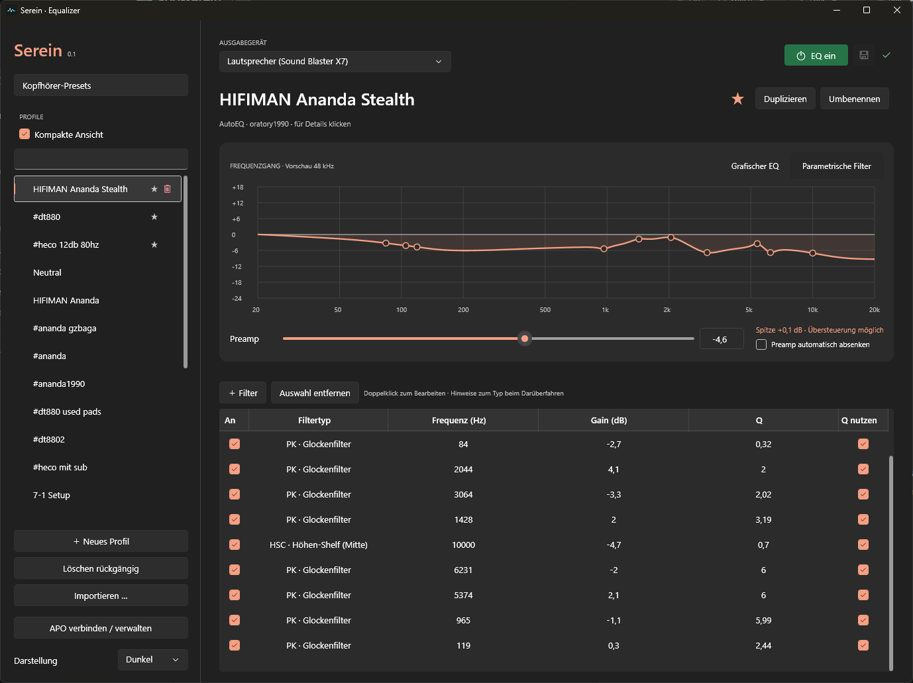

# Serein

A Windows front end for Equalizer APO with graphic and parametric EQ, per-device profiles, Peace profile import, and a searchable AutoEQ catalog. Available in English and German.

## Install

Download the installer or portable ZIP from [Releases](https://github.com/Duffed/apo-serein/releases/latest). Serein runs on Windows x64 (Windows 10 22H2 or later) and includes the .NET runtime.

Install [Equalizer APO](https://sourceforge.net/projects/equalizerapo/) separately. Close Peace, then open **Settings → Equalizer APO** to enable APO for your output device and connect Serein.

Serein shows a warning if Equalizer APO is missing from the selected output device or Windows audio enhancements are disabled for that device.

## Build

Run `./build.ps1` on Windows with the .NET 10 SDK. Serein is licensed under [GPL-2.0-or-later](LICENSE.txt).
